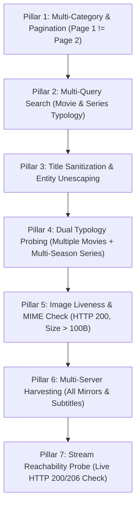

# 02. Local JVM Testing Loop (Headless Validation)

> **THE GOLDEN ADVANTAGE**:
> Unlike legacy workflows where developers deploy APKs to an Android phone or TV and guess through Logcat, this environment enables **instant JVM unit testing**. You can execute live scraping, verify DOM selectors, sanitize messy titles, assert live image rendering, parse multi-season episodes, and verify playable video streams on your PC in **under 5 seconds**.

---

## 1. The 7 Fatal Testing Shortcuts Agents Take (And Why Plugins Fail on Device)

When AI agents build plugins hurriedly, they often take fatal shortcuts that pass basic assertions but completely break on user devices:

1. **The Single-Title Trap**:
   * *The Shortcut*: Testing only 1 movie and declaring the plugin functional.
   * *Why it breaks*: TV series have completely different HTML layouts (season dropdowns, Ajax episode loaders, season/episode numbering). When a user clicks a TV series on Android TV, the app crashes or shows an empty episode list.
2. **The Page-1-Only Trap**:
   * *The Shortcut*: Testing only `getMainPage(1, ...)`.
   * *Why it breaks*: Pagination logic (`?page=2`, `/page/2/`, or JSON offsets) is frequently broken in scrapers. If Page 2 returns the exact same items as Page 1, CloudStream gets stuck in an infinite scroll loop.
3. **The Raw Release Noise Title Trap**:
   * *The Shortcut*: Extracting raw text from HTML without sanitization.
   * *Why it breaks*: Scraped titles like `"Avatar (2022) [1080p] [Dual Audio] WEBRip x264 &amp; Watch Free"` look terrible in CloudStream UI and cause TMDB/Cinemeta metadata matching to fail completely.
4. **The Broken Image URL Trap**:
   * *The Shortcut*: Assuming a non-null `posterUrl` string means images render.
   * *Why it breaks*: Scrapers frequently capture relative URLs (`/uploads/thumb.jpg`), protocol-relative URLs (`//cdn...`), or dummy base64 SVG placeholders. On Android, `BitmapFactory` or Coil fails silently, displaying blank grey cards.
5. **The Single-Query Search Trap**:
   * *The Shortcut*: Searching for a single hardcoded title (e.g. `"Batman"`).
   * *Why it breaks*: Search results often return mixed media types (Movies, TV Series, OVAs). If the parser assumes all results are movies, series items lose episode navigation.
6. **The Single-Mirror Harvesting Trap**:
   * *The Shortcut*: Resolving only the first iframe found on a page.
   * *Why it breaks*: Modern streaming portals provide multiple servers/mirrors (e.g. Server 1: Primary, Server 2: Mirror A, Server 3: Mirror B). If Server 1 is geo-blocked or rate-limited, users have no alternative playable streams unless all available servers are harvested.
7. **The Unverified Stream False-Positive Trap**:
   * *The Shortcut*: Asserting `link.url.isNotBlank()` without checking reachability.
   * *Why it breaks*: Extractors often return `.m3u8` links that require specific `Referer` or `User-Agent` headers. Without verifying HTTP status (200/206), the link fails with `403 Forbidden` in ExoPlayer.

---

## 2. Running the Test Suite

From the terminal in the workspace root, run the test task scoped to your target module:

```bash
./gradlew :<PluginName>:testDebugUnitTest
```
*(On Windows PowerShell: `.\gradlew.bat :<PluginName>:testDebugUnitTest`)*

Or run with detailed standard output to see scraped URLs, image probes, and extracted stream mirrors live:

```bash
./gradlew :<PluginName>:testDebugUnitTest --info
```
*(On Windows PowerShell: `.\gradlew.bat :<PluginName>:testDebugUnitTest --info`)*

---

## 3. The 7-Pillar Mandatory Testing Protocol

Every production CloudStream plugin test suite must implement the **7-Pillar Probing Architecture**:



### Pillar 1: Multi-Category & Multi-Page Traversal
* Must probe at least 2 distinct categories from `mainPage` (e.g. Movies row and TV Shows row).
* Must fetch **Page 1 AND Page 2** for each category.
* **Assertion**: Verify `page2.list.isNotEmpty()` AND verify that Page 2 items are not a duplicate mirror of Page 1 (`overlap.size < page1.list.size`).

### Pillar 2: Multi-Query Search & Typology Assertion
* Must test search with at least 2 diverse queries (e.g. a movie keyword and a TV series keyword).
* **Assertion**: Verify each query returns non-empty results with valid title, URL, and correct `TvType`.

### Pillar 3: Title Sanitization & Entity Hygiene
* Verify that scraped titles are processed through `CommonUtils.cleanTitle(raw)`:
  * Strips quality tags (`1080p`, `720p`, `4k`, `web-dl`, `bluray`).
  * Strips codec and audio clutter (`x264`, `hevc`, `dual audio`, `multi audio`).
  * Strips promotional noise (`watch online`, `download free`).
  * Unescapes HTML entities (`&amp;` -> `&`, `&#039;` -> `'`).
* **Assertion**: Verify `cleanTitle` output contains zero raw release tags or unescaped entities.

### Pillar 4: Dual Typology Probing (Both Movies AND TV Series)
* **Movies**: Probe at least 2 diverse movie titles (e.g., a recent release and an older title with different HTML layouts). Assert clean title, poster URL, release year, and non-empty `dataUrl`.
* **TV Series**: Probe at least 2 diverse TV series. Assert multi-season grouping (`seasons.isNotEmpty()`), episode ordering, episode titles, and non-empty episode `data` payloads across different seasons.

### Pillar 5: Image Liveness & Reachability Probe
* Collect `posterUrl` and `backgroundPosterUrl` from loaded movie and series responses.
* Assert URLs are absolute HTTP/HTTPS links (`startsWith("http")`) and not base64 SVG placeholders.
* Perform a live HTTP probe via `app.get(imgUrl, timeout = 10)`.
* **Assertion**: Verify HTTP status is `200..308` and image body size is greater than 100 bytes.

### Pillar 6: Multi-Server & Multi-Mirror Link Harvesting
* Call `loadLinks` on:
  1. A Movie `dataUrl`.
  2. A TV Series episode `data` payload.
* **Assertion**: Verify that all available servers/mirrors (Primary, Mirror A, Mirror B, etc.) are harvested. Collect all `ExtractorLink` items and verify URL format, extractor name, and quality tags.

### Pillar 7: Stream Reachability Probe (Live HTTP Check)
* Probe extracted stream URLs with an HTTP HEAD or partial GET request (`Range: bytes=0-1024`) using `app.get(link.url, headers = link.headers)`.
* **Assertion**: Verify HTTP status is `200` or `206` (or `< 400`), confirming the stream is live and not blocked by hotlink protection or 403 barriers.

---

## 4. Gradle Dependencies & Runtime Configuration for Headless Tests

Because CloudStream's Gradle plugin injects `cloudstream.jar` as `compileOnly` for the Android library target, Android Gradle Plugin (AGP) excludes it from `testCompileClasspath` by default. Furthermore, `MainAPIKt` requires `kotlinx.serialization.json` and JUnit 5 launcher at test runtime.

Configure your module's `build.gradle.kts` with these exact test dependencies:

```kotlin
dependencies {
    // 1. CloudStream core jar on test classpath
    testImplementation(files("${System.getProperty("user.home")}/.gradle/caches/cloudstream/cloudstream/cloudstream.jar"))

    // 2. JUnit 5 Platform & Launchers
    testImplementation("org.junit.jupiter:junit-jupiter-api:5.10.0")
    testRuntimeOnly("org.junit.jupiter:junit-jupiter-engine:5.10.0")
    testRuntimeOnly("org.junit.platform:junit-platform-launcher:1.10.0")

    // 3. Serializers & Coroutines required by CloudStream MainAPIKt
    testImplementation("org.jetbrains.kotlinx:kotlinx-serialization-json:1.6.3")
    testImplementation("org.jetbrains.kotlinx:kotlinx-coroutines-core:1.8.0")
    testImplementation("org.json:json:20231013")
}

android {
    testOptions {
        unitTests.isReturnDefaultValues = true
        unitTests.all {
            it.useJUnitPlatform()
        }
    }
}
```

In root `build.gradle.kts`, ensure Kotlin compiler flags bypass metadata mismatch on pre-release jars:
```kotlin
tasks.withType<KotlinJvmCompile> {
    compilerOptions {
        jvmTarget.set(JvmTarget.JVM_1_8)
        freeCompilerArgs.addAll(
            "-Xno-call-assertions",
            "-Xno-param-assertions",
            "-Xno-receiver-assertions",
            "-Xskip-metadata-version-check"
        )
    }
}
```

---

## 5. Production Reference Test Suite (`ExampleTest.kt`)

Refer directly to [`templates/ExamplePlugin/src/test/kotlin/com/example/ExampleTest.kt`](../templates/ExamplePlugin/src/test/kotlin/com/example/ExampleTest.kt) for the complete reference implementation incorporating all 7 pillars.

---

## 5. Fast Debugging Matrix for Common Test Failures

| Error / Failure Symptom | Root Cause | Solution |
| :--- | :--- | :--- |
| `AssertionError: Page 2 is duplicate of Page 1` | Pagination query param is ignored or hardcoded to page 1. | Verify whether target uses `?page=2`, `/page/2/`, or an offset parameter like `?offset=20`. |
| `AssertionError: Cleaned title still contains release tags` | The site uses unhandled release tags (e.g. `WEBRip-DDP5.1`). | Add the missing pattern to `CommonUtils.cleanTitle()`. |
| `AssertionError: Poster failed to load with HTTP 404/403` | Relative URL not resolved, or CDN requires `Referer`. | Use `CommonUtils.cleanImageUrl(raw, mainUrl)` to resolve absolute URL. |
| `ClassCastException: ... cannot be cast to MovieLoadResponse` | The movie URL actually points to a TV series or miniseries. | Inspect target breadcrumbs or tags to dynamically route to `newTvSeriesLoadResponse`. |
| `AssertionError: Series episodes list is empty` | Episodes are rendered via client-side JavaScript or Ajax endpoint. | Inspect DevTools Network tab for `/ajax/episodes/list?id=...` and fetch that endpoint directly. |
| `AssertionError: Stream link returned HTTP error 403` | Stream CDN requires specific `Referer` or `Origin` headers. | Add `headers = mapOf("Referer" to mainUrl)` to the `ExtractorLink` constructor. |
| `HTTP 403 Forbidden` / `Just a moment` | Cloudflare challenge or bot protection. | Use `app.get(url, interceptor = CloudflareClearanceInterceptor)` or verify User-Agent. |
| `Method ... not mocked` | Android framework class called in pure JVM. | Ensure `testOptions { unitTests.isReturnDefaultValues = true }` is in `build.gradle.kts`. |
| `Extractor returned 0 links` | The iframe host changed domain or token format. | Inspect iframe URL; inherit from built-in extractor or update regex. |
