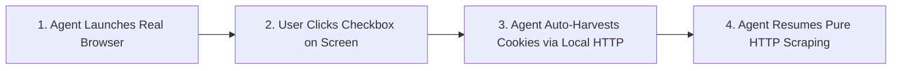
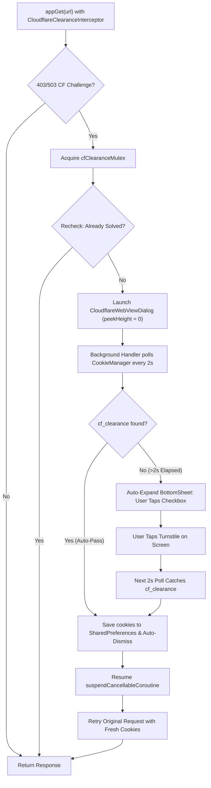

# 04. Web Session Management, Challenge Resolution & Cryptographic Handshakes

> **CORE PRINCIPLE**:
> Modern media platforms deploy browser environment checks, managed challenges (such as Turnstile), and client-side WebAssembly (WASM) payload decoders. This guide provides the standard architecture used by CloudStream plugins to negotiate client sessions, establish valid clearance cookies, and decode media payloads seamlessly.

---

## 1. The 5-Step Pure HTTP Client Negotiation Ladder

When scratchpad probing encounters web challenges (HTTP 403, 503, or verification screens), systematically execute this 5-step ladder over pure HTTP:

1. **Step 1 (TLS Fingerprint Negotiation)**: Re-probe with `curl_cffi` using `impersonate="chrome120"`. If the server verifies client JA3/JA4 fingerprints, the request completes immediately with HTTP 200.
2. **Step 2 (API & Mobile Gateway Check)**: Check if mobile subdomains (e.g. `m.example.com`, `app.example.com`) or REST endpoints (`/api/...`, `/ajax/...`) serve data directly.
3. **Step 3 (Mirror & TLD Rotation)**: Probe official alternate domains (`.is`, `.st`, `.wf`, `.vg`) provided by the service.
4. **Step 4 (Web Archive Cached Snapshot)**: Query `https://archive.org/wayback/available?url={url}` to fetch a recent DOM snapshot over pure HTTP to inspect all CSS selectors without triggering verification screens.
5. **Step 5 (The Interactive Browser Bridge)**: When a target requires interactive verification during initial developer probing, launch the Interactive Browser Bridge below.

---

## 2. The Interactive Browser Clearance Bridge (Zero Manual Token Copying)

> **THE ZERO-FRICTION DEVELOPER WORKFLOW**:
> The developer should **never** have to manually inspect network tabs or copy-paste token strings. The agent launches the user's real browser window, the developer completes the on-screen check, and the agent automatically receives the clearance session in the background via local HTTP.

### The Automated 3-Step Flow:


1. **Agent Launches Real Desktop Browser**:
   The agent launches the installed system browser (Chrome, Edge, or Brave) with a local debugging port:
   ```python
   # scratch/solve_cf.py
   import subprocess
   import shutil
   import os

   def launch_browser(url):
       browser = (
           shutil.which("msedge") or
           shutil.which("chrome") or
           shutil.which("google-chrome") or
           r"C:\Program Files (x86)\Microsoft\Edge\Application\msedge.exe" or
           r"C:\Program Files\Google\Chrome\Application\chrome.exe"
       )
       # Launches normal browser window with local debug port
       cmd = [browser, "--remote-debugging-port=9222", url]
       subprocess.Popen(cmd)
   ```
2. **User Clicks Checkbox**:
   A normal browser window pops up on the user's screen. The user clicks the Cloudflare checkbox with their mouse.
3. **Agent Auto-Harvests via Pure Local HTTP**:
   The agent polls `http://localhost:9222/json` via standard HTTP. The moment the page title changes from *"Just a moment..."* to the real website title:
   * The agent pulls the clearance cookies and User-Agent automatically.
   * It flushes them to `scratch/cf_session.json`.
   * It continues pure HTTP scraping, writes the Kotlin code, and runs headless JVM tests.

---

## 3. Production Android Cloudflare Architecture (`CloudflareWebViewDialog`)

In production CloudStream plugins, Cloudflare challenges on Android are handled using the battle-tested **`CloudflareWebViewDialog` BottomSheet Pattern**:



### 1. The OkHttp Interceptor & Mutex Wrapper
```kotlin
object CloudflareClearanceInterceptor : Interceptor {
    override fun intercept(chain: Interceptor.Chain): Response {
        val original = chain.request()
        val builder = original.newBuilder()
            .removeHeader("X-Requested-With")
            .header("sec-ch-ua-mobile", "?1")
            .header("sec-ch-ua-platform", "\"Android\"")

        val savedUa = MyPlugin.cfUserAgent
        if (savedUa.isNotBlank()) builder.header("User-Agent", savedUa)

        val savedCookies = MyPlugin.cfCookies
        if (savedCookies.isNotBlank()) {
            val existing = original.header("Cookie") ?: ""
            val base = existing.split(";").map { it.trim() }.filter { it.isNotEmpty() && !it.startsWith("cf_clearance=") }
            val fresh = savedCookies.split(";").map { it.trim() }.filter { it.isNotEmpty() }
            builder.header("Cookie", (base + fresh).distinct().joinToString("; "))
        }

        return chain.proceed(builder.build())
    }
}

// Mutex-guarded wrapper around app.get:
private val cfClearanceMutex = Mutex()

fun isCloudflareBlocked(response: NiceResponse): Boolean {
    if (response.code != 403 && response.code != 503) return false
    val body = response.text.lowercase()
    return listOf("just a moment", "checking your browser", "verify you are human", "cf-browser-verification", "cf-chl-widget").any { body.contains(it) }
}

suspend fun appGet(url: String, headers: Map<String, String> = emptyMap()): NiceResponse {
    val raw = app.get(url, headers = headers, interceptor = CloudflareClearanceInterceptor)
    if (!isCloudflareBlocked(raw)) return raw

    var recheckPassed: NiceResponse? = null
    cfClearanceMutex.withLock {
        val recheck = app.get(url, headers = headers, interceptor = CloudflareClearanceInterceptor)
        if (!isCloudflareBlocked(recheck)) {
            recheckPassed = recheck
        } else {
            showCloudflareClearanceDialogAndWait(url)
        }
    }
    recheckPassed?.let { return it }
    return app.get(url, headers = headers, interceptor = CloudflareClearanceInterceptor)
}

suspend fun showCloudflareClearanceDialogAndWait(url: String): Boolean = withContext(Dispatchers.Main) {
    suspendCancellableCoroutine { cont ->
        val activity = CommonActivity.activity as? AppCompatActivity
        if (activity == null || activity.isFinishing || activity.isDestroyed) {
            cont.resume(false)
            return@suspendCancellableCoroutine
        }
        var resumed = false
        fun safeResume(success: Boolean) {
            if (!resumed) { resumed = true; cont.resume(success) }
        }
        val dialog = CloudflareWebViewDialog(targetUrl = url, onFinished = { safeResume(it) })
        cont.invokeOnCancellation {
            activity.runOnUiThread { runCatching { dialog.dismissAllowingStateLoss() } }
        }
        dialog.show(activity.supportFragmentManager, "cf_clearance_auto")
    }
}
```

### 2. The `CloudflareWebViewDialog` (BottomSheet Lifecycle)
```kotlin
class CloudflareWebViewDialog(
    private val targetUrl: String,
    private val onFinished: ((Boolean) -> Unit)? = null,
    private val startExpanded: Boolean = false
) : BottomSheetDialogFragment() {

    private val handler = Handler(Looper.getMainLooper())
    private var cookiesSaved = false
    private var pollElapsedMs = 0L

    private val targetHost: String by lazy {
        try {
            val uri = targetUrl.toUri()
            "${uri.scheme}://${uri.host}"
        } catch (_: Exception) { targetUrl }
    }

    private val cookiePollRunnable = object : Runnable {
        override fun run() {
            if (cookiesSaved || !isAdded) return
            CookieManager.getInstance().flush()

            val cookieStr = CookieManager.getInstance().getCookie(targetHost) ?: ""
            val cfRegex = Regex("cf_clearance=[^;]{15,}")
            val isChallenge = CHALLENGE_TITLES.any { (webView?.title ?: "").lowercase().contains(it) }

            if (cfRegex.containsMatchIn(cookieStr) && !isChallenge) {
                // Clearance cookie verified! Save and auto-dismiss
                cookiesSaved = true
                MyPlugin.cfCookies = cookieStr
                MyPlugin.cfUserAgent = webView?.settings?.userAgentString ?: ""
                onFinished?.invoke(true)
                dismissAllowingStateLoss()
                return
            }

            // Schedule next poll or expand if user interaction required
            pollElapsedMs += 2000L
            if (pollElapsedMs >= 2000L && !startExpanded) {
                // If not solved within 2s, slide up so user can tap the Turnstile checkbox
                (dialog as? BottomSheetDialog)?.behavior?.state = BottomSheetBehavior.STATE_EXPANDED
            }
            handler.postDelayed(this, 2000L)
        }
    }

    override fun onCreateDialog(savedInstanceState: Bundle?): Dialog {
        val dialog = super.onCreateDialog(savedInstanceState)
        if (!startExpanded) {
            // Start completely invisible (peekHeight = 0) so background auto-solves are silent
            dialog.window?.setDimAmount(0f)
            dialog.window?.addFlags(WindowManager.LayoutParams.FLAG_NOT_TOUCH_MODAL)
            (dialog as? BottomSheetDialog)?.behavior?.apply {
                state = BottomSheetBehavior.STATE_COLLAPSED
                peekHeight = 0
            }
        }
        return dialog
    }
}
```

### 3. Built-in `WebViewResolver` for Media Link Interception
For extracting `.m3u8` streams from embedded players protected by Turnstile or JWPlayer scripts, CloudStream provides the built-in `WebViewResolver`:
```kotlin
import com.lagradost.cloudstream3.network.WebViewResolver

val resolver = WebViewResolver(
    interceptUrl = Regex("""\.m3u8"""),
    script = """document.querySelector('.jw-icon-display')?.click();""",
    timeout = 15_000L
)

val response = app.get(embedUrl, referer = mainUrl, interceptor = resolver)
```

---

## 4. In-Memory WebAssembly (WASM) Decryption

Some video players compile their decryption algorithms into WebAssembly (`.wasm`) to prevent JavaScript reversal.

### The Kotlin WASM Execution Recipe:
Rather than writing native JNI C++ bindings, top plugins run the WASM module directly inside a lightweight, invisible WebView JS runtime:

1. Base64-encode the `.wasm` binary into a Kotlin constant (`private const val WASM_B64 = "AGFzbQEAAAA..."`).
2. Instantiate WebAssembly in memory:
   ```kotlin
   val initJs = """
       (async function() {
           const binary = Uint8Array.from(atob('$WASM_B64'), c => c.charCodeAt(0));
           const { instance } = await WebAssembly.instantiate(binary, {
               env: { abort: () => console.log('abort') }
           });
           window.wasmInstance = instance;
           window.WasmBridge.onReady();
       })();
   """.trimIndent()
   webView.evaluateJavascript(initJs, null)
   ```
3. Allocate input buffers, invoke the WASM export, and read the decrypted output pointer:
   ```javascript
   function decryptData(encryptedHex) {
       const exports = window.wasmInstance.exports;
       const inPtr = exports.alloc(encryptedHex.length);
       // Write to WASM memory, execute, and read output
       const outLen = exports.run(inPtr, encryptedHex.length);
       const outPtr = exports.outPtr();
       const result = new Uint8Array(exports.memory.buffer, outPtr, outLen);
       window.WasmBridge.onDecrypted(new TextDecoder().decode(result));
   }
   ```

---

## 5. Cryptographic Request Signatures & Session Token Negotiation

### Double-Base64 HMAC-MD5 (Mobile BFF Request Signing Pattern):
```kotlin
private fun generateHmacSignature(
    method: String,
    url: String,
    body: String?,
    timestamp: Long,
    rawSecretBytes: ByteArray
): String {
    val path = java.net.URI(url).path ?: ""
    val bodyHash = if (!body.isNullOrBlank()) md5(body.toByteArray()) else ""
    val canonicalString = "${method.uppercase()}\n$timestamp\n$bodyHash\n$path"

    val mac = javax.crypto.Mac.getInstance("HmacMD5")
    mac.init(javax.crypto.spec.SecretKeySpec(rawSecretBytes, "HmacMD5"))
    val hash = mac.doFinal(canonicalString.toByteArray(Charsets.UTF_8))
    
    return android.util.Base64.encodeToString(hash, android.util.Base64.NO_WRAP)
}
```

### HMAC-SHA256 & SHA-256 Key Derivation Pattern:
Used by mobile APIs to validate request payload timestamps and client authenticity:
```kotlin
fun generateHmacSha256(payload: String, secretKey: ByteArray): String {
    val mac = javax.crypto.Mac.getInstance("HmacSHA256")
    mac.init(javax.crypto.spec.SecretKeySpec(secretKey, "HmacSHA256"))
    val bytes = mac.doFinal(payload.toByteArray(Charsets.UTF_8))
    return bytes.joinToString("") { "%02x".format(it) }
}

fun sha256Bytes(input: ByteArray): ByteArray {
    return java.security.MessageDigest.getInstance("SHA-256").digest(input)
}
```

### JWT Expiration Parser (Zero-Library & KMP-Safe):
Extract the `exp` timestamp from a JWT without adding heavy third-party JWT libraries:
```kotlin
@kotlinx.serialization.Serializable
private data class JwtPayload(val exp: Long? = null)

fun decodeJwtExpiry(token: String): Long {
    return try {
        val payload = token.split(".").getOrNull(1) ?: return 0L
        val padded = payload.replace("-", "+").replace("_", "/")
            .let { it + "=".repeat((4 - it.length % 4) % 4) }
        val json = java.util.Base64.getDecoder().decode(padded).toString(Charsets.UTF_8)
        com.lagradost.cloudstream3.utils.AppUtils.tryParseJson<JwtPayload>(json)?.exp ?: 0L
    } catch (_: Exception) {
        0L
    }
}

---

## 6. The Zero-Wait Protocol for Fake Client-Side Timers & Link Lockers

> **THE GOLDEN INSIGHT**:
> Link shorteners (e.g. Safelinker, Flylink, Gplinks, Droplink, Hrefli, Shortlink, Naukriadda) display countdown timers (5–15 seconds) purely as client-side JavaScript (`setTimeout` / `setInterval`) to force human visitors to look at advertisements.
> **The backend web server almost NEVER validates real elapsed wall-clock time.**
> Inserting arbitrary `Thread.sleep()` or `delay()` in your plugin ruins UX and leads to ExoPlayer loading timeouts. AI agents must systematically execute the **Zero-Wait Protocol** to bypass fake timers in milliseconds.

### The 4 Automated Routes to Sub-Second Bypass:

#### Route 1: The Direct Multi-Step Form Chain (Zero Delay)
When a shortener uses multi-page countdown forms (`landing.php` -> `step2.php` -> destination):
1. **Never sleep.** Extract the hidden form action and inputs (`_wp_http`, `_wp_http2`, tokens).
2. Immediately fire the POST request.
3. Extract the session token from the response (e.g. `script:containsData(?go=)`).
4. Send the final GET request with the required token cookie.
The entire 15-second human countdown executes in **under 200 milliseconds** over pure HTTP!

```kotlin
suspend fun bypassFastShortener(url: String): String? {
    val host = URI(url).let { "${it.scheme}://${it.host}" }
    var doc = app.get(url).document

    // Step 1: Immediate form submission without timer wait
    var formUrl = doc.selectFirst("form#landing")?.attr("action") ?: return null
    var formData = doc.select("form#landing input").associate { it.attr("name") to it.attr("value") }
    doc = app.post(formUrl, data = formData).document

    // Step 2: Immediate second POST
    formUrl = doc.selectFirst("form#landing")?.attr("action") ?: formUrl
    formData = doc.select("form#landing input").associate { it.attr("name") to it.attr("value") }
    doc = app.post(formUrl, data = formData).document

    // Step 3: Extract token and retrieve destination instantly
    val skToken = doc.selectFirst("script:containsData(?go=)")?.data()
        ?.substringAfter("?go=")?.substringBefore("\"") ?: return null

    val destUrl = app.get("$host?go=$skToken", cookies = mapOf(skToken to "${formData["_wp_http2"]}")).document
        .selectFirst("meta[http-equiv=refresh]")?.attr("content")?.substringAfter("url=")

    return destUrl
}
```

#### Route 2: The Timer Callback Reverse-Engineering
When JavaScript shows a visual countdown before revealing the link:
* In your scratchpad, do **not** run the timer. Search `<script>` tags for what function executes when the counter reaches 0 (`count == 0` or `clearInterval(timer)`):
  ```javascript
  // Target script inspection:
  if (counter <= 0) {
      clearInterval(interval);
      window.location.href = atob("aHR0cHM6Ly9zdHJlYW0ub3JnL2ZpbGUvMTIz");
  }
  ```
* **Bypass**: Extract the argument of `atob(...)` or the URL pattern directly using regex, decode it in Kotlin in 1ms, and skip the countdown completely.

#### Route 3: Pre-Rendered Hidden DOM Elements
* In over 40% of link shorteners, the destination URL is already present in the initial server HTML, merely hidden with CSS (`display: none;` or `visibility: hidden;`). The timer script simply calls `element.style.display = 'block'`.
* **Bypass**: Query hidden attributes directly via Jsoup:
  `doc.selectFirst("a[data-href], a[data-url], a.get-link, input#final_url")?.attr("data-href")`

#### Route 4: Direct AJAX/API Endpoint Extraction
* When the countdown ends, many shorteners fire an AJAX request to fetch the destination:
  `fetch('/api/v1/links/unlock', { method: 'POST', body: JSON.stringify({ token: '...' }) })`
* **Bypass**: Extract the endpoint and token from `<script>`, fire the POST immediately using `app.post()`, and grab the unlocked link in sub-second time.
```
