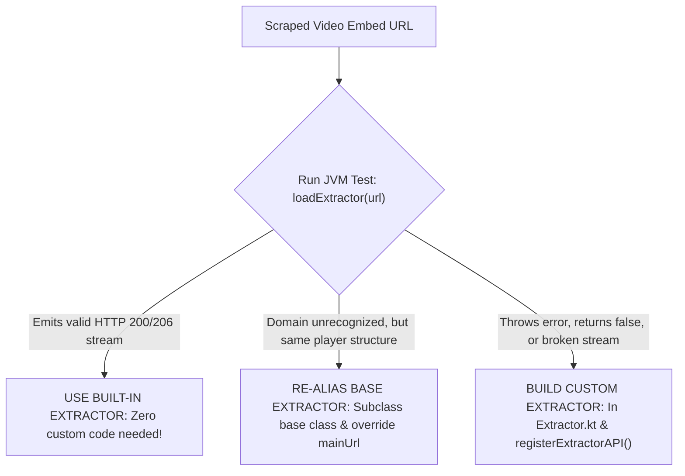
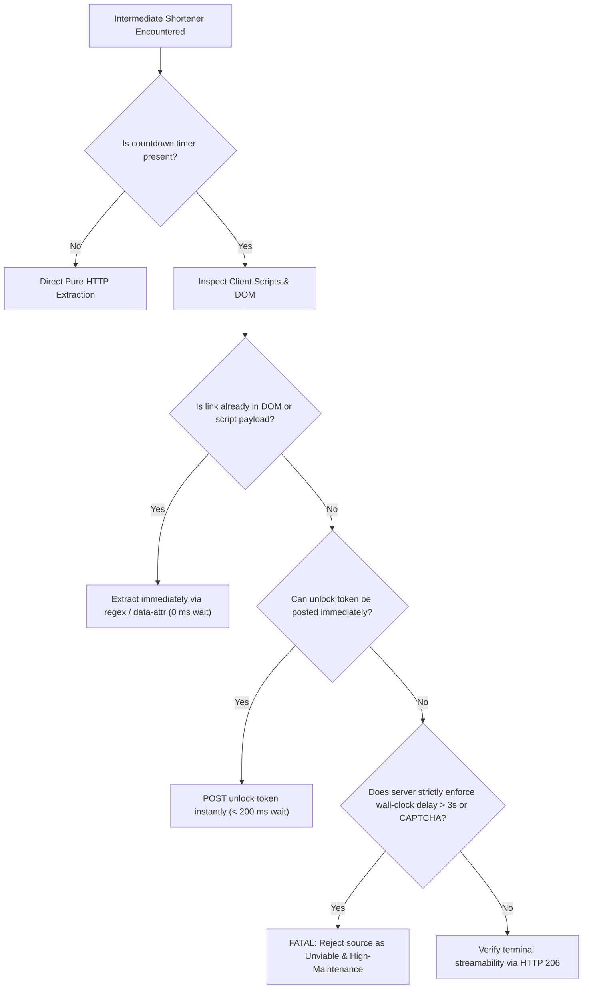

# 05. Streams, Protocols & Extractor Engineering Guide

> **CORE PRINCIPLE**:
> CloudStream relies on `ExtractorLink` models to feed ExoPlayer. Correctly distinguishing between HLS (`.m3u8`), DASH (`.mpd`), and direct MP4 streams, as well as handling signed cookies, ensures smooth, buffer-free playback.

---

## 1. Stream Types & Model Mapping

When passing links to the playback callback, assign the correct `ExtractorLinkType`:

```kotlin
val linkType = when {
    streamUrl.contains(".m3u8", ignoreCase = true) -> ExtractorLinkType.M3U8
    streamUrl.contains(".mpd", ignoreCase = true)  -> ExtractorLinkType.DASH
    else                                          -> INFER_TYPE
}

callback.invoke(
    newExtractorLink(
        source = "MySource",
        name = "MySource (1080p)",
        url = streamUrl,
        type = linkType
    ) {
        this.referer = "https://example.com/"
        this.quality = Qualities.P1080.value
        this.headers = mapOf(
            "User-Agent" to "Mozilla/5.0 ...",
            "Cookie" to "session=xyz"
        )
    }
)
```

---

## 2. Leveraging the Built-in Extractor Cascade (`loadExtractor`)

CloudStream bundles over **100+ built-in file host extractors** in `library/src/commonMain/kotlin/com/lagradost/cloudstream3/extractors/` (including `StreamTape`, `MixDrop`, `DoodStream`, `Filemoon`, `StreamWish`, `Gofile`, `Mp4Upload`, `Vidhide`, `Upstream`, `Voe`, `Krakenfiles`, `PixelDrain`, `HubCloud`, etc.).

### 2.1 The Architectural Mechanics: Reverse-Order Precedence
In `ExtractorApi.kt`, all extractors are kept in the global list `val extractorApis: AtomicMutableList<ExtractorApi>`.
When `loadExtractor(url, ...)` is called:
```kotlin
// Iterate in reverse order so the new registered ExtractorApi takes priority
for (index in extractorApis.lastIndex downTo 0) {
    val extractor = extractorApis[index]
    if (compareUrl.startsWith(extractor.mainUrl.replace(schemaStripRegex, ""))) {
        extractor.getUrl(currentUrl, referer, subtitleCallback, callback)
        return true
    }
}
```
**Key Rule**: Because it iterates from `lastIndex downTo 0`, any custom extractor registered in your plugin (`registerExtractorAPI(...)`) is appended to the list and **automatically overrides and shadows the built-in extractor**!

---

### 2.2 How to Verify if a Built-in Extractor Works (JVM Test Pattern)

File hosts update their obfuscation and player layouts frequently. You must NEVER blindly guess whether a built-in extractor works. Test it directly in your plugin's unit tests:

```kotlin
@Test
fun testBuiltInHostExtractor() = runTest {
    val sampleEmbedUrl = "https://streamwish.to/e/abcd1234" // Scraped from target
    val extractedStreams = mutableListOf<ExtractorLink>()

    // 1. Invoke the cascade
    val matched = loadExtractor(
        url = sampleEmbedUrl,
        subtitleCallback = {},
        callback = { link -> extractedStreams.add(link) }
    )

    println("Matched Extractor: $matched")
    println("Extracted Links: ${extractedStreams.size}")

    // 2. Validate stream viability via HTTP 206 Partial Content
    assertTrue("Extractor failed to resolve stream", extractedStreams.isNotEmpty())
    val stream = extractedStreams.first()
    val headers = stream.headers + mapOf("Range" to "bytes=0-1024")
    val res = app.get(stream.url, headers = headers, referer = stream.referer)
    println("Stream Handshake: HTTP ${res.code} (Type: ${res.headers["Content-Type"]})")
    assertTrue("Stream not playable", res.code in listOf(200, 206))
}
```

---

### 2.3 The Extractor Decision Matrix: When to Use What



1. **Option A: Built-in Works**:
   - In your provider's `loadLinks`:
     ```kotlin
     loadExtractor(embedUrl, subtitleCallback, callback)
     ```
   - No extractor files or custom classes required.
2. **Option B: Mirror Domain of a Working Extractor**:
   - The player layout, API, and pack/unpack logic match a known extractor (e.g. `StreamWishExtractor`), but the domain is different (`https://newwish.xyz`).
   - Subclass the built-in extractor and register:
     ```kotlin
     class NewWish : StreamWishExtractor() {
         override val name = "NewWish"
         override val mainUrl = "https://newwish.xyz"
     }
     ```
     In `Plugin.kt`: `registerExtractorAPI(NewWish())`.
3. **Option C: Built-in is Broken or Host is Unique**:
   - The file host changed its token handshake or uses unique packer/crypto.
   - Write a custom `ExtractorApi` subclass and register with `registerExtractorAPI()`.
   - Your registered extractor will immediately take precedence over CloudStream's built-in one!

---

### 2.4 Real-Time Upstream Sync & Developer Transparency Protocol

Every plugin creation cycle must execute with zero guesswork and full step-by-step reporting to the developer:

1. **Step 1: Upstream Sync Check**:
   The agent checks and synchronizes with `recloudstream/cloudstream`:
   ```bash
   python scripts/sync_upstream_extractors.py --sync
   ```
   *Reports to developer: "Synchronized upstream repository: 300+ native file host extractors indexed."*

2. **Step 2: Scraped Host Cross-Check**:
   When embed links are discovered on the target site, they are immediately cross-checked:
   ```bash
   python scripts/sync_upstream_extractors.py --check <embed_url>
   ```
   *Reports to developer: "Cross-checked host against CS3 upstream: [Match Found: StreamWishExtractor / Mirror Match / Proprietary]."*

3. **Step 3: Live JVM Handshake**:
   The matched extractor is tested directly on JVM to assert that the terminal media stream returns HTTP 200/206 Partial Content in $\le 3000\,\text{ms}$.
   *Reports to developer: "Live JVM Handshake: HTTP 206 Partial Content verified in 420ms."*

4. **Step 4: Real-Time Skill Evolution**:
   Whenever a new working pattern, extractor workaround, or mirror alias is validated, document it in `references/` so future plugins instantly reuse the verified solution.

---

## 3. Re-Aliasing Extractor Base Classes (The Rapid Alias Pattern)

When streaming sites deploy cloned domains or mirrors of supported hosters (e.g. `primary-host.example` -> `mirror-domain.example`), **do not write new extractors from scratch**. Inherit from the supported base class and override `mainUrl`:

```kotlin
// Example: Subclassing an existing core extractor that handles an identical player
class MirrorHostExtractorA : BaseSupportedExtractor() {
    override var name = "FastServer Mirror A"
    override var mainUrl = "https://mirror-a.example.com"
}

class MirrorHostExtractorB : BaseSupportedExtractor() {
    override var name = "FastServer Mirror B"
    override val mainUrl = "https://mirror-b.example.com"
}
```
*Register these in your `BasePlugin.load()` using `registerExtractorAPI()`.*

---

## 4. CloudFront-Policy DASH Manifest Resolution (Resolving Signed Policy Streams)

Many advanced CDNs return a fake dummy `.mp4` (e.g. 5-second copyright warning video) in the `url` attribute, but hide the real master `.mpd` playlist inside the AWS signed cookie `signCookie`:

```kotlin
/**
 * Decodes the AWS CloudFront-Policy attribute to reveal the real index.mpd URL.
 */
fun extractPolicyResource(signCookie: String?): String? {
    if (signCookie.isNullOrBlank()) return null
    val match = Regex("""CloudFront-Policy=([^;]+)""").find(signCookie) ?: return null
    var policyRaw = match.groupValues[1]
    
    // Fix Base64 padding and URL characters
    val rem = policyRaw.length % 4
    if (rem > 0) policyRaw += "=".repeat(4 - rem)
    policyRaw = policyRaw.replace('-', '+').replace('_', '/')

    return try {
        val decodedJson = base64Decode(policyRaw)
        val root = mapper.readTree(decodedJson)
        val resource = root["Statement"]?.get(0)?.get("Resource")?.asText() ?: return null
        val trimmed = resource.trimEnd('*', '/')
        if (trimmed.endsWith(".mpd", ignoreCase = true)) trimmed else "$trimmed/index.mpd"
    } catch (_: Exception) {
        null
    }
}
```

---

## 5. Instant JavaScript Unpacking (`getAndUnpack` & `JsUnpacker`)

Many video embed players obfuscate their stream links using the classic Dean Edwards packer (`eval(function(p,a,c,k,e,d)...)`). **Never spin up a WebView to unpack these.** CloudStream bundles built-in unpackers that execute in 1 millisecond on the CPU:

```kotlin
import com.lagradost.cloudstream3.utils.getPacked
import com.lagradost.cloudstream3.utils.getAndUnpack
import com.lagradost.cloudstream3.utils.JsUnpacker

// Pattern: Cascade from packed JS to standard script parsing
val script = when {
    !getPacked(html).isNullOrEmpty() -> getAndUnpack(html)
    html.contains("eval(function(p,a,c,k,e,d)") -> JsUnpacker(html).unpack()
    else -> html
}

// Extract the unpacked stream URL instantly:
val streamUrl = Regex("""file:\s*["']([^"']+\.m3u8[^"']*)["']""").find(script ?: "")?.groupValues?.get(1)
    ?: Regex("""sources:\s*\[\s*\{\s*file:\s*["']([^"']+)["']""").find(script ?: "")?.groupValues?.get(1)
```

---

## 6. Multi-Quality Master Playlist Extraction (`M3u8Helper`)

Instead of writing custom HLS parsing logic, use CloudStream's core `M3u8Helper.generateM3u8`. It automatically fetches the master `.m3u8`, parses all resolution streams (1080p, 720p, 480p, 360p), and passes individual `ExtractorLink`s to `callback`:

```kotlin
import com.lagradost.cloudstream3.utils.M3u8Helper

M3u8Helper.generateM3u8(
    name = this.name,
    source = masterM3u8Url,
    referer = referer ?: "$mainUrl/",
    headers = mapOf(
        "User-Agent" to USER_AGENT,
        "Origin" to (referer ?: mainUrl)
    )
).forEach(callback)
```

---

## 7. Direct In-Memory AES Source Decryption (AES-CBC & Ephemeral Keys)

Top-tier video hosts return an encrypted Base64 string in their JSON response or HTML `<script>` tags instead of plain URLs. Decrypt directly in Kotlin using Java Cryptography Architecture (JCA):

### Pattern A: AES-CBC Decryption (URL-Safe Base64)
```kotlin
import javax.crypto.Cipher
import javax.crypto.spec.IvParameterSpec
import javax.crypto.spec.SecretKeySpec
import com.lagradost.cloudstream3.base64DecodeArray

fun decryptAesCbc(encryptedBase64: String, keyString: String, ivString: String): String? = runCatching {
    // 1. Normalize URL-safe Base64 and restore padding
    val normalized = encryptedBase64.replace('-', '+').replace('_', '/')
    val padded = normalized + "=".repeat((4 - normalized.length % 4) % 4)
    val data = base64DecodeArray(padded)

    // 2. Pad or truncate key to 32 bytes (256-bit AES)
    val rawKey = keyString.toByteArray(Charsets.UTF_8)
    val keyBytes = if (rawKey.size < 32) rawKey + ByteArray(32 - rawKey.size) else rawKey.copyOf(32)

    // 3. Decrypt
    val cipher = Cipher.getInstance("AES/CBC/PKCS5Padding")
    cipher.init(
        Cipher.DECRYPT_MODE,
        SecretKeySpec(keyBytes, "AES"),
        IvParameterSpec(ivString.toByteArray(Charsets.UTF_8).copyOf(16))
    )
    String(cipher.doFinal(data))
}.getOrNull()
```

### Pattern B: Extracting Ephemeral Keys from Module Scripts
Some video players generate ephemeral keys embedded in `<script type="module">`:
```kotlin
val script = document.selectFirst("script[type=module]")?.data().orEmpty()
val videoB64 = Regex("""video_b64:\s*["']([^"']+)["']""").find(script)?.groupValues?.get(1)
val keyB64 = Regex("""enc_key_b64:\s*["']([^"']+)["']""").find(script)?.groupValues?.get(1)
val ivB64 = Regex("""iv_b64:\s*["']([^"']+)["']""").find(script)?.groupValues?.get(1)

if (videoB64 != null && keyB64 != null && ivB64 != null) {
    val decryptedJson = decryptAesCbc(videoB64, keyB64, ivB64)
    // Extract stream link directly from decrypted JSON
}
```

### Pattern C: AES-GCM Authenticated Decryption (`AES/GCM/NoPadding`)
Advanced modern streaming hosts wrap player configs in AES-GCM authenticated payloads (standard 12-byte IV + 128-bit authentication tag):

```kotlin
import javax.crypto.Cipher
import javax.crypto.spec.GCMParameterSpec
import javax.crypto.spec.SecretKeySpec
import com.lagradost.cloudstream3.base64DecodeArray

fun decryptAesGcm(
    cipherBytes: ByteArray,
    keyBytes: ByteArray,
    ivBytes: ByteArray,
    tagLenBits: Int = 128
): String? = runCatching {
    val cipher = Cipher.getInstance("AES/GCM/NoPadding")
    val keySpec = SecretKeySpec(keyBytes, "AES")
    val gcmSpec = GCMParameterSpec(tagLenBits, ivBytes)
    cipher.init(Cipher.DECRYPT_MODE, keySpec, gcmSpec)
    val plain = cipher.doFinal(cipherBytes)
    
    // Strip UTF-8 Byte Order Mark (BOM) if present:
    var text = plain.decodeToString()
    if (text.startsWith("\uFEFF")) text = text.substring(1)
    text
}.getOrNull()
```

### Pattern D: Multi-Host Download Gateways (Two-Hop Resolution & Custom Redirects)
Many media providers route video streams through intermediate multi-host gateway landing pages (e.g. an initial landing page that redirects to a download hub with multiple server mirrors):

```kotlin
open class MultiHostGatewayExtractor : ExtractorApi() {
    override val name = "GatewayServer"
    override var mainUrl = "https://gateway.example.com"
    override val requiresReferer = false

    override suspend fun getUrl(
        url: String,
        referer: String?,
        subtitleCallback: (SubtitleFile) -> Unit,
        callback: (ExtractorLink) -> Unit
    ) {
        // Step 1: Two-Hop Resolution -> Follow #download href to reach the direct hub page
        val hubUrl = if ("download.php" in url) {
            url
        } else {
            val landingDoc = app.get(url).document
            val downloadHref = landingDoc.selectFirst("#download, a.btn-download")?.attr("href") ?: return
            if (downloadHref.startsWith("http")) downloadHref else fixUrl(downloadHref)
        }

        val hubDoc = app.get(hubUrl).document

        // Step 2: Parse card metadata (Resolution & File Size)
        val headerText = hubDoc.selectFirst("div.card-header")?.text().orEmpty()
        val sizeText = hubDoc.selectFirst("i#size")?.text().orEmpty()
        val quality = Regex("(\\d{3,4})[pP]").find(headerText)?.groupValues?.getOrNull(1)?.toIntOrNull()
            ?: Qualities.P1080.value

        // Step 3: Iterate multi-server buttons
        hubDoc.select("div.card-body h2 a.btn, div.card-body a.btn").amap { btn ->
            val link = btn.attr("href")
            val btnText = btn.text()

            when {
                // Direct video streaming mirrors:
                btnText.contains("Server A", ignoreCase = true) ||
                btnText.contains("Server B", ignoreCase = true) ||
                btnText.contains("Download", ignoreCase = true) -> {
                    callback.invoke(
                        newExtractorLink(
                            source = name,
                            name = "$name [$btnText] [$sizeText]",
                            url = link,
                            type = ExtractorLinkType.VIDEO
                        ) { this.quality = quality }
                    )
                }

                // Redirect servers: Fetch download endpoint with allowRedirects=false and read redirect header
                btnText.contains("RedirectServer", ignoreCase = true) -> {
                    val resp = app.get("$link/download", referer = link, allowRedirects = false)
                    val directStream = resp.headers["hx-redirect"] ?: resp.headers["Location"]
                    if (!directStream.isNullOrBlank()) {
                        callback.invoke(
                            newExtractorLink(
                                source = "RedirectServer",
                                name = "RedirectServer [$sizeText]",
                                url = directStream,
                                type = ExtractorLinkType.VIDEO
                            ) { this.quality = quality }
                        )
                    }
                }

                // Storage API endpoint transformation:
                btnText.contains("Storage", ignoreCase = true) -> {
                    val fileId = link.substringAfterLast("/")
                    val directUrl = "https://storage.example.com/api/file/$fileId?download"
                    callback.invoke(
                        newExtractorLink(
                            source = "StorageServer",
                            name = "StorageServer [$sizeText]",
                            url = directUrl,
                            type = ExtractorLinkType.VIDEO
                        ) { this.quality = quality }
                    )
                }

                // Cascade remaining links to CloudStream's global extractor registry:
                else -> loadExtractor(link, subtitleCallback, callback)
            }
        }
    }
}

// Wildcard domain alias:
class MultiHostGatewayWildcard : MultiHostGatewayExtractor() {
    override var mainUrl = "https://*.gateway.example.com"
}
```

### Pattern E: Intermediate Gateway & Shortener Resolution
Many providers route links through intermediate gateways (e.g. `href.li`, landing pages, timer redirects):

```kotlin
// 1. Direct href.li Referer stripping bypass:
fun unwrapHrefLi(url: String): String {
    return if (url.contains("href.li/?")) url.substringAfter("href.li/?") else url
}

// 2. Chasing HTTP 301/302 Location headers without following redirect:
suspend fun resolveRedirectLocation(url: String, referer: String? = null): String {
    val headers = if (referer != null) mapOf("Referer" to referer) else emptyMap()
    val response = app.get(url, headers = headers, allowRedirects = false)
    return response.headers["Location"] ?: url
}

// 3. Automated HTML Landing Page Form Submission:
suspend fun resolveFormGateway(landingUrl: String): String? {
    val doc = app.get(landingUrl).document
    val form = doc.selectFirst("form[action]") ?: return null
    val actionUrl = fixUrl(form.attr("action"))
    
    val formParams = mutableMapOf<String, String>()
    form.select("input[name]").forEach { input ->
        formParams[input.attr("name")] = input.attr("value")
    }
    
    val response = app.post(actionUrl, data = formParams, referer = landingUrl)
    return response.document.selectFirst("a.download-btn, a[href*='drive']")?.attr("href")
}
```

### Pattern F: Resolution Quality Mapping (`Qualities`)
Map scraped resolution labels or numeric heights to CloudStream's standard `Qualities` enum for UI playback badges:

```kotlin
import com.lagradost.cloudstream3.Qualities

fun mapQuality(qualityString: String?): Int {
    val digits = qualityString?.filter { it.isDigit() }?.toIntOrNull() ?: return Qualities.Unknown.value
    return when {
        digits >= 2160 -> Qualities.P2160.value
        digits >= 1440 -> Qualities.P1440.value
        digits >= 1080 -> Qualities.P1080.value
        digits >= 720  -> Qualities.P720.value
        digits >= 480  -> Qualities.P480.value
        digits >= 360  -> Qualities.P360.value
        else           -> Qualities.Unknown.value
    }
}
```

---

## 8. Subtitle Extraction & Model Formatting

Pass subtitles to `subtitleCallback` using `newSubtitleFile`:

```kotlin
import com.lagradost.cloudstream3.newSubtitleFile

subtitleCallback.invoke(
    newSubtitleFile(
        lang = track.optString("name", "English"),
        url = fixUrl(track.optString("file", ""))
    )
)
```

---

## 9. The Link Velocity Benchmark & Flexible Extraction Timeline (≤ 10s Ceiling)

CloudStream plugins operate on Android mobile devices and Android TV boxes. While ultra-fast sub-second resolution is ideal, realistic video sites frequently require multi-hop Pure HTTP redirects or token exchanges that may take several seconds.

### 9.1 The Flexible 10-Second Ceiling & Non-Blocking Feedback

Rather than enforcing dogmatic, rigid abort-rules, the extractor probing pipeline operates with a **flexible 10-second practical ceiling** and **non-blocking real-time feedback**:

$$\text{Total Extraction Latency} = \sum_{i=1}^{N} \text{Hop Latency}_i \le 10000\,\text{ms}$$

| Latency Range | Assessment | Agent Action |
| :--- | :--- | :--- |
| **< 3000 ms** | **Fast / Optimal** | Proceed immediately; optimal for Android TV instant start. |
| **3000 – 10000 ms** | **Acceptable / Normal** | Report latency breakdown to dev; proceed if terminal stream is valid. |
| **> 10000 ms** | **Slow / High Overhead** | Provide non-blocking feedback warning; dev decides whether to proceed or switch. |

* **Non-Blocking Rule**: Minor latency delays should never cause the agent to rigidly crash or refuse to proceed. The agent must provide live, transparent feedback during initial testing so the developer can make informed engineering decisions.
* **Network Protocol**: Must remain **100% Pure HTTP** (`NiceHttp` / `app.get()` / `app.post()`) because heavy browser engines or headless runtimes cannot execute inside Android Dex.
* **Timer Handling**: Test for sub-second zero-wait bypass (< 500 ms) using form tokens, script inspection, or unhiding DOM attributes.

---

### 9.2 Fake Timers vs. Server Delays: The Feasibility Decision Tree

Shorteners and link lockers frequently display 5, 10, or 15-second countdown timers ("Please wait 10 seconds before your link is ready"). In 95% of web video sites, these countdowns are **client-side cosmetic illusions** designed to maximize ad impression view-time:



#### How to Expose Fake Timers in Scratchpad Probing:
1. **Hidden DOM Inspection**: Search response HTML for hidden input tags or data attributes (`data-href`, `data-url`, `value="base64..."`). If the destination URL is already in the DOM, bypass time is **0 ms**.
2. **Immediate POST Probe**: Test sending the form POST payload immediately with a zero timestamp (`{"time": 0}` or `{"step": "final"}`). If the server returns the destination link without validating an elapsed wall-clock interval, bypass time is **sub-second**.
3. **Decryption Script Probe**: If the link is generated via client JS (`atob()`, rot13, XOR), extract the encrypted string and decrypt it natively in Kotlin.

#### The Hard Stop Rule:
If a shortener:
* Enforces server-side timestamp validation (e.g., token generated on initial GET and rejected by server if POSTed before 10 real seconds elapse), OR
* Embeds Cloudflare Turnstile, hCaptcha, or reCAPTCHA challenges inside intermediate hops, OR
* Chains through 4+ distinct redirect domains (`domain1.in` $\rightarrow$ `domain2.xyz` $\rightarrow$ `domain3.blog` $\rightarrow$ `stream.mkv`)

**THE AGENT MUST STOP IMMEDIATELY.** Do NOT attempt to build workarounds, do NOT insert `delay(10000)`, and do NOT scaffold a plugin module.

---

### 9.3 The Non-Blocking Latency Feedback Protocol

When a target exceeds the 10-second ceiling or displays high-churn shorteners, the agent delivers constructive, non-blocking feedback:

> **⚠️ Latency & Maintenance Feedback**:
> - **Target Pipeline**: Target routes through 3 intermediate hops (`domain-a.xyz` $\rightarrow$ `domain-b.in` $\rightarrow$ `stream.m3u8`).
> - **Latency Benchmark**: Pure HTTP resolution completed in 7200 ms (within 10s ceiling).
> - **Stream Verification**: HTTP 206 Partial Content verified (playable stream confirmed).
> - **Developer Choice**: Would you like to proceed with this fast-path extractor, or inspect cleaner mirror sources?

---

### 9.4 On-Demand Open-Source & Upstream Repository Inspection (Only When Needed)

When encountering an exotic player architecture, an unhandled cipher/packer, or when major CloudStream SDK refactoring is noticed:
* **Check Open-Source Reference Repos**: Suggest or inspect public community repositories (such as [`recloudstream/extensions`](https://github.com/recloudstream/extensions), [`recloudstream/TestPlugins`](https://github.com/recloudstream/TestPlugins), or trusted community extension repos) to see how other developers solved that specific host or player layout.
* **Check Official CloudStream Core**: Check the upstream repository (`scratch/cloudstream`) or GitHub commit log if a signature, extractor model, or helper method behaves unexpectedly.
* **Strict On-Demand Trigger**: This step is executed **strictly on-demand** when a roadblock or novel pattern arises, never on standard, straightforward plugins.

---

## 10. Long-Term Plugin Maintenance: Updating Mirror Domains & Hosts

Streaming providers and file lockers rotate domains frequently to bypass ISP blocks and registrar bans. Plugins must be designed so the developer can perform maintenance with minimal friction.

### 10.1 Site Domain Rotation (When `site.to` becomes `site.xyz`)
1. Open `<PluginName>Provider.kt`:
   ```kotlin
   override var mainUrl = "https://new-domain.xyz" // Updated from old domain
   ```
2. In `<PluginName>/build.gradle.kts`, increment the integer version:
   ```kotlin
   version = 2 // Incremented so Android app downloads the updated Dex!
   ```
3. Recompile and serve:
   ```bash
   ./gradlew :<PluginName>:make
   python scripts/serve_cs3.py
   ```

### 10.2 Video Host Mirror Domain Updates
When an underlying file host changes its domain (e.g. `streamwish.to` moves to `streamwish.site`):
1. In `<PluginName>Extractor.kt`, define a subclass aliasing the new domain:
   ```kotlin
   class StreamWishMirror : StreamWishExtractor() {
       override val name = "StreamWish Mirror"
       override val mainUrl = "https://streamwish.site"
   }
   ```
2. In `<PluginName>Plugin.kt`:
   ```kotlin
   registerExtractorAPI(StreamWishMirror())
   ```
3. Increment `version = version + 1` and recompile with `:make`.

### 10.3 The Developer's Real-World Feedback Loop
Because Android TV devices and mobile networks vary:
- Always test compiled `.cs3` binaries on your target hardware via local Wi-Fi repo (`python scripts/serve_cs3.py`).
- Feed player errors back to the agent (e.g. `UnrecognizedInputFormatException` or `HTTP 403`) to update extractors and evolve the skill files in real-time.
