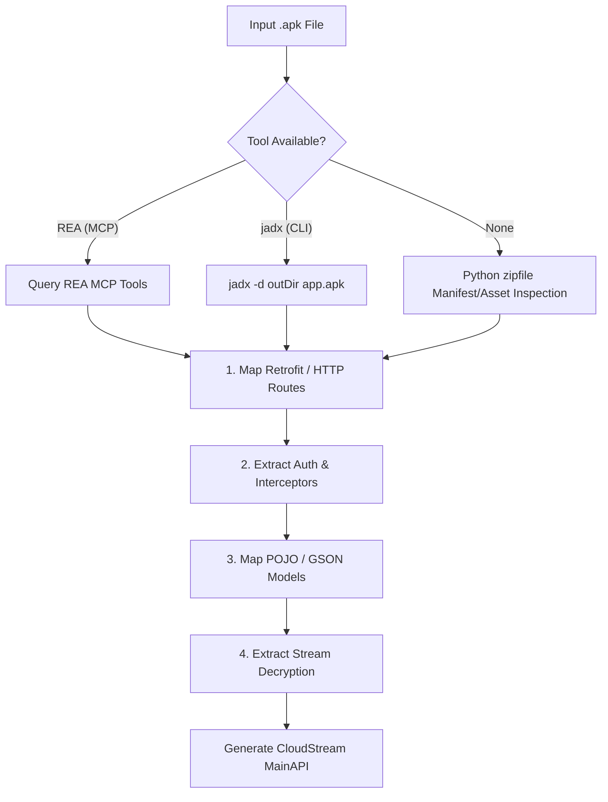

# 12. APK Reverse-Engineering & Mobile API Extraction

> **PORTABLE AGENT DIRECTIVE**:
> When a user provides an Android APK (`.apk`) file instead of a website URL, use this playbook to statically analyze the compiled app, extract its private API routes, decode request-signing algorithms, and scaffold a CloudStream plugin.

---

## 1. Universal Environment Setup (For Any Machine)

### Option A: Portable REA MCP Server (Recommended for AI Agents)
Add the following generic block to the client's `mcp_config.json` (Cursor, Claude Code, Antigravity, etc.):

```json
{
  "mcpServers": {
    "rea": {
      "command": "npx",
      "args": ["-y", "rea-agents", "mcp"],
      "env": {
        "REA_LOG_LEVEL": "silent",
        "REA_MCP_INPUT_SCHEMA_PROFILE": "compact"
      }
    }
  }
}
```

### Option B: System CLI Toolchain (`jadx`)
Ensure `jadx` is available on the system `PATH`:
* **Windows**: `scoop install jadx` or `choco install jadx`
* **macOS**: `brew install jadx`
* **Linux**: `sudo apt install jadx` or download from `github.com/skylot/jadx/releases`

---

## 2. Autonomous Reconnaissance Workflow for APKs

When an agent is given an `.apk` file, it executes the following steps in sequence:



---

## 3. The 4 Extraction Targets

### Target 1: Base URLs & API Interfaces (Retrofit)
Android streaming apps almost universally use Square's `Retrofit`. Search decompiled sources for interface annotations:

* **Search Patterns**:
  * `@GET(`, `@POST(`, `@Headers(`
  * `baseUrl(`, `HttpUrl.parse(`
  * `Retrofit.Builder`

* **What to Extract**:
  ```kotlin
  // Decompiled interface in target APK:
  interface ApiService {
      @GET("api/v1/content/browse")
      fun getHomeContent(@Query("page") page: Int): Call<HomeResponse>
      
      @GET("api/v1/content/detail/{id}")
      fun getDetails(@Path("id") id: String): Call<DetailResponse>
      
      @GET("api/v1/stream/sources")
      fun getStreamLinks(@Query("media_id") id: String): Call<StreamResponse>
  }
  ```
  *The agent immediately knows the exact URL endpoints and query parameters to call with CloudStream's `app.get()`.*

---

### Target 2: Request Interceptors & Dynamic Auth Headers
Streaming apps protect their APIs using custom headers (e.g. app tokens, timestamp hashes, client fingerprints).

* **Search Patterns**:
  * `implements Interceptor`, `OkHttpClient.Builder`
  * `.addInterceptor(`, `.addNetworkInterceptor(`
  * `chain.proceed(`, `header("Authorization"`

* **Common Signing Logic to Replicate**:
  ```kotlin
  // Example decompiled interceptor logic:
  class AuthInterceptor : Interceptor {
      override fun intercept(chain: Interceptor.Chain): Response {
          val timestamp = System.currentTimeMillis() / 1000
          // App-specific signature: MD5(secretKey + timestamp)
          val sign = md5("APP_SECRET_KEY" + timestamp)
          
          val request = chain.request().newBuilder()
              .header("X-App-Time", timestamp.toString())
              .header("X-App-Sign", sign)
              .header("X-App-Platform", "android")
              .build()
          return chain.proceed(request)
      }
  }
  ```
  *Replicate this header construction inside the CloudStream provider's helper functions.*

---

### Target 3: Mapping Data Models to CloudStream Responses
Decompiled data classes or POJOs (GSON / Jackson models) show the exact JSON schema returned by the server.

* **Search Patterns**:
  * `@SerializedName(`, `@JsonProperty(`
  * Fields with names like `title`, `poster`, `stream_url`, `episodes`

* **Direct CloudStream Translation**:
  ```kotlin
  // Map APK response model directly into CloudStream types:
  val json = app.get(apiUrl, headers = authHeaders).parsedSafe<ApiHomeResponse>()
  
  val searchResults = json?.items?.mapNotNull { item ->
      newMovieSearchResponse(
          name = item.title ?: return@mapNotNull null,
          url = item.id.toString(),
          type = if (item.isSeries == true) TvType.TvSeries else TvType.Movie
      ) {
          this.posterUrl = item.posterUrl
          this.year = item.releaseYear
      }
  }
  ```

---

### Target 4: Video Player & Stream Decryption
Locate the class responsible for initializing `ExoPlayer` or resolving stream URLs:

* **Search Patterns**:
  * `MediaItem.fromUri`, `setMediaItem(`
  * `DefaultHttpDataSource.Factory`
  * `.m3u8`, `.mpd`, `AES/CBC/PKCS5Padding`

* **What to Extract**:
  * Custom `Referer` or `User-Agent` headers required by the video CDN.
  * Any pre-request token exchange endpoint (e.g. `POST /api/v1/play/ticket`).
  * AES encryption keys or IVs passed to encrypted HLS/DASH streams.

---

## 4. Headless CLI Extraction Script (Zero GUI Needed)

When operating purely from the terminal without an interactive GUI:

```bash
# 1. Decompile APK directly to Java sources
jadx -d ./decompiled_app --no-res app.apk

# 2. Search for API endpoints
grep -rnw "./decompiled_app" -e "baseUrl" -e "@GET" -e "@POST"

# 3. Search for headers and signing secrets
grep -rnw "./decompiled_app" -e "addInterceptor" -e "Authorization"
```

Once endpoints, headers, and schemas are extracted, the agent switches immediately to **Phase 3 (Core Implementation)** and **Phase 4 (Local JVM Unit Testing)** in [`SKILL.md`](../SKILL.md).
